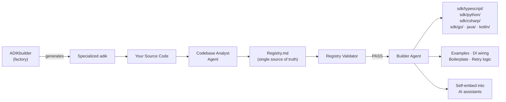

# ADIK — Agentic Development and Implementation Kit

[](https://github.com/sponsors/mateors1)
[](https://creativecommons.org/licenses/by/4.0/)
[](http://www.apache.org/licenses/LICENSE-2.0)

**ADIK** is a framework standard for producing **adiks** — self-sustaining agentic SDKs. ADIKbuilder generates a specialized bundle of cooperating AI agents that reads your codebase, builds a language-agnostic symbol registry, generates publish-ready SDK packages, produces framework-idiomatic integration boilerplate, and self-embeds into your AI tools — so your SDKs stay in sync with your code and developers can adopt them with zero friction, automatically.

> **Terminology:** An **adik** (lowercase) is the deliverable — a self-sustaining agentic SDK that includes both the generated SDK packages *and* the agents that produced them, so it can maintain itself.

> Read the full philosophy in the [Manifesto](docs/specification/manifesto.md). New to ADIK? Start with the [Quickstart Guide](docs/getting-started/quickstart-guide.md).

---

## How It Works



1. **ADIKbuilder** (this repo) is the factory — it produces specialized adiks tailored to your project.
2. **Codebase Analyst Agent** scans your source and populates `Registry.md` with every public symbol.
3. **Registry Validator** runs a three-level gate (structural, type, semantic) before any generation.
4. **Builder Agent** coordinates SDK generation across all configured languages.
5. **SDK Consumer Skill** produces framework-idiomatic examples, DI wiring, retry wrappers, and integration boilerplate — so developers can adopt the SDK immediately, not just receive it.
6. **Self-Embedding** injects ADIK context into your AI tools (Copilot, Claude, Cursor) so any assistant working in the repo understands the SDK and can help implement it.
7. **MCP Server** *(optional)* exposes the full pipeline as tools — your coding agent can regenerate SDKs, query the registry, or scaffold new integrations on demand.

The adik is **self-sustaining** — it carries its own agents and skills, so on every commit the pipeline re-runs and the SDKs stay in sync with your code. Everything is optional beyond the core pipeline. Vector search, MCP server, tier-2 languages, and framework hints all degrade gracefully when not configured.

> See [Architecture](docs/specification/architecture.md) for the full system diagram.

---

## Quick Start

### 1. Deploy the adik into your project

```bash
python3 scripts/adik-deploy.py --target /path/to/your/project/
```

The deploy script assembles and copies the adik bundle: `ADIK.md`, `ADIK.orchestrator.md`, `Registry.md`, `Registry.index.md`, `agents/`, `skills/`, `scripts/` (excluding `adik-deploy.py` itself), `mcp/`.

### 2. Run the Codebase Analyst

```
@agent codebase-analyst
task: analyse-and-register
target: ./src
output: Registry.md
```

### 3. Run the Builder

```
@agent builder
task: build-sdk
registry: Registry.md
languages: [typescript, python, csharp]
```

Generated SDKs appear in `sdk/typescript/`, `sdk/python/`, and `sdk/csharp/`.

> **Optional:** Create `adik.config.json` for tier-2 languages, custom output paths, or vector settings. If omitted, ADIK uses sensible defaults.

---

## Supported Languages

| Tier | Language | Package Manager | Output |
|---|---|---|---|
| **1** | TypeScript | npm / pnpm / yarn | ESM + CJS + `.d.ts` |
| **1** | Python | pip / poetry / uv | Wheel + sdist |
| **1** | C# | NuGet | `.nupkg` |
| **2** *(opt-in)* | Go | go modules | Go module |
| **2** *(opt-in)* | Java | Maven / Gradle | JAR |
| **2** *(opt-in)* | Kotlin | Gradle | JAR (coroutines) |

Tier-2 languages require `tier2Languages` in `adik.config.json`.

---

## Repository Structure

This repository contains the ADIK **framework source** — both the specification and the reference implementation.

```
├── ADIK.md                            ← Standard definition (deployed as part of every adik)
├── ADIK.orchestrator.md               ← Operational orchestrator (deployed as part of every adik)
├── ADIKbuilder.md                     ← Framework orchestrator (source repo only — never deployed)
├── Registry.md                        ← Symbol registry template (deployed)
├── Registry.index.md                  ← Partitioned registry master index (deployed)
├── CHANGELOG.md                       ← Version history
├── agents/
│   ├── builder.agent.md               ← SDK Builder Agent
│   └── codebase-analyst.agent.md      ← Codebase Analyst Agent
├── skills/
│   ├── sdk-builder.skill.md           ← Tier-1 SDK generation (TS / Python / C#)
│   ├── sdk-builder-tier2.skill.md     ← Tier-2 SDK generation (Go / Java / Kotlin — opt-in)
│   ├── sdk-consumer.skill.md          ← Framework-idiomatic consumption boilerplate
│   ├── registry-validator.skill.md    ← Mandatory pre-generation validation gate
│   └── vectorize.skill.md             ← Vector embedding subskill (loaded on demand)
├── scripts/
│   ├── adik-deploy.py                 ← Factory-side bundle assembly and deployment (source repo only)
│   ├── adik-embed.py                  ← Deterministic self-embedding into context files
│   └── adik-eject.py                  ← Clean uninstall / eject protocol
├── mcp/
│   └── adik-mcp-server.md             ← MCP server definition
├── docs/
│   ├── index.md                       ← Documentation site home
│   ├── getting-started/               ← Onboarding & configuration
│   │   ├── quickstart-guide.md        ← 15-minute first-run walkthrough
│   │   ├── pre-deployment.md          ← Bundle walkthrough before first run
│   │   ├── configuration.md           ← adik.config.json reference
│   │   ├── cheatsheet-building.md     ← Quick-ref for building an adik
│   │   └── cheatsheet-consuming.md    ← Quick-ref for consuming a generated SDK
│   ├── specification/                 ← Formal standard & design
│   │   ├── standard.md                ← ADIK Standard Specification
│   │   ├── architecture.md            ← System architecture with Mermaid diagrams
│   │   └── manifesto.md               ← Philosophy and principles
│   ├── examples/                      ← Showcases & implementation guides
│   │   ├── showcase-payments-api.md   ← NestJS REST API showcase
│   │   ├── showcase-task-manager.md   ← FastAPI showcase
│   │   ├── showcase-chat-service.md   ← TypeScript WebSocket showcase
│   │   ├── ADIKBuilderExample.md      ← Build your own ADIK from scratch
│   │   └── scaffold.md                ← Master bootstrap prompt
│   ├── security/
│   │   └── red-team-audit-v2.md       ← Post-v2.0 security audit
│   └── community/
│       └── launch-posts.md            ← Social media launch content
├── adik-lint.py                       ← ADIK.md specification linter
├── mkdocs.yml                         ← MkDocs Material site config
├── LICENSE                            ← CC BY 4.0 (spec) + Apache 2.0 (impl)
└── .github/
    ├── copilot-instructions.md        ← GitHub Copilot context
    └── workflows/
        ├── adik-self-deploy.yml       ← CI/CD bundle deployment
        ├── adik-ci.yml                ← Optional integration testing (registry + type-check)
        └── docs.yml                   ← GitHub Pages docs deployment
```

### What Gets Deployed (the adik) vs. What Stays Here

| Deployed as part of the adik | Source repo only |
|---|---|
| `ADIK.md`, `ADIK.orchestrator.md`, `Registry.md`, `Registry.index.md` | `ADIKbuilder.md`, `CHANGELOG.md` |
| `agents/`, `skills/`, `scripts/` *(excluding `adik-deploy.py`)*, `mcp/` | `scripts/adik-deploy.py`, `docs/`, `adik-lint.py`, `mkdocs.yml` |
| *(context files created by `adik-embed.py`)* | `CLAUDE.md`, `agents.md`, `.github/` |

---

## Key Concepts

### Two Orchestrators

| File | Role | Audience |
|---|---|---|
| `ADIKbuilder.md` | **Factory** — produces specialized adiks | Framework maintainers |
| `ADIK.md` | **Standard Definition** — defines what ADIK is, its terminology, and contracts | Everyone |
| `ADIK.orchestrator.md` | **Operational Orchestrator** — the brain inside every adik, drives SDK generation in target repos | SDK consumers |

### DRY Registry

Every symbol is declared once in `Registry.md` and generated into all languages from that single definition. For large codebases (≥ 500 symbols), the registry auto-partitions into domain-scoped files (`Registry.<domain>.md`) indexed by `Registry.index.md`.

### Self-Embedding

When deployed, `scripts/adik-embed.py` injects ADIK context into `.github/copilot-instructions.md`, `CLAUDE.md`, and `agents.md` using `<!-- ADIK:START -->` / `<!-- ADIK:END -->` guard markers — idempotent and safe to run repeatedly.

### Ejecting ADIK

```bash
python3 scripts/adik-eject.py --target . --dry-run    # preview what will be removed
python3 scripts/adik-eject.py --target . --confirm     # execute removal
```

Source code is never touched. Only ADIK artifacts are removed.

---

## Documentation

| Document | Description |
|---|---|
| **[Quickstart Guide](docs/getting-started/quickstart-guide.md)** | 15-minute first-run walkthrough |
| **[Pre-Deployment Walkthrough](docs/getting-started/pre-deployment.md)** | What the bundle looks like before running |
| **[Configuration Reference](docs/getting-started/configuration.md)** | `adik.config.json` schema and defaults |
| **[Cheat Sheet: Building](docs/getting-started/cheatsheet-building.md)** | Quick-reference for deploying and running the ADIK pipeline |
| **[Cheat Sheet: Consuming](docs/getting-started/cheatsheet-consuming.md)** | Quick-reference for integrating a generated SDK |
| **[ADIK Standard Specification](docs/specification/standard.md)** | Formal spec — what makes a framework ADIK-compatible |
| **[Architecture](docs/specification/architecture.md)** | System diagram, delegation model, data flow |
| **[Manifesto](docs/specification/manifesto.md)** | Philosophy and core principles |
| **[Showcase: Payments API](docs/examples/showcase-payments-api.md)** | Full example — NestJS REST API |
| **[Showcase: Task Manager](docs/examples/showcase-task-manager.md)** | Full example — FastAPI with webhooks |
| **[Showcase: Chat Service](docs/examples/showcase-chat-service.md)** | Full example — TypeScript WebSocket + REST |
| **[Build Your Own ADIK](docs/examples/ADIKBuilderExample.md)** | Step-by-step construction guide |
| **[Scaffold (Master Prompt)](docs/examples/scaffold.md)** | Single file that bootstraps ADIK into any repo |
| **[Red-Team Audit v2](docs/security/red-team-audit-v2.md)** | Security audit and risk matrix |
| **[Roadmap](ROADMAP.md)** | Planned features and version timeline |
| **[Changelog](CHANGELOG.md)** | Version history |
| **[GitHub Spec Kit: Analysis & Integration](docs/ecosystem/spec-kit.md)** | How ADIK complements GitHub Spec Kit — positioning, compliance, extension proposal |

### Building the docs locally

```bash
pip install -r requirements-docs.txt
mkdocs serve
```

---

## ADIK Linter

```bash
python adik-lint.py [FILE]     # defaults to ADIK.md
```

Validates frontmatter, required sections, and registry marker matching. Exit code `0` = pass.

---

## Licensing

| Component | License |
|---|---|
| **Specification** — `ADIK.md`, `ADIK.orchestrator.md`, `ADIKbuilder.md`, `Registry.md`, `docs/` | [CC BY 4.0](https://creativecommons.org/licenses/by/4.0/) |
| **Reference Implementation** — `agents/`, `skills/`, `scripts/`, `mcp/`, `adik-lint.py` | [Apache 2.0](http://www.apache.org/licenses/LICENSE-2.0) |

See [`LICENSE`](LICENSE) for full terms.

---

## Sponsor

If ADIK saves you time or you believe in the future of agentic SDKs, consider [sponsoring the project](https://github.com/sponsors/mateors1). Sponsorships fund continued development, documentation, and community support.

[](https://github.com/sponsors/mateors1)

---

## Contributing

Improvements to agent definitions, skill templates, or the registry format are welcome as pull requests. Please keep agent and skill files self-contained — each file should be independently readable by an LLM agent without loading the entire repository.

See [`ADIKbuilder.md`](ADIKbuilder.md) for the framework evolution workflow and versioning rules.
