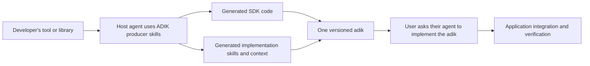

# ADIK — Agentic Development and Implementation Kit

**ADIK is a skill suite for building SDKs for agents.** A tool or library developer
asks their coding agent to build an **adik**. Generation produces actual SDK code
and the skills, contracts, examples, and context needed to implement it—together
in one versioned bundle.

A user then asks their agent to implement that adik in application code. The agent
already has the library knowledge in the bundle and can focus its inspection on the
application's integration points.



[Visual walkthrough](docs/specification/architecture.md) ·
[Producer quickstart](docs/getting-started/quickstart-guide.md) ·
[Consumer guide](docs/getting-started/consumer-guide.md) ·
[Runnable reference adik](docs/examples/reference-adik.md)

## Build an adik

Use a coding agent with this repository available and ask:

> Read `skills/build-adik/SKILL.md`. Build an adik from my library. Generate the SDK
> code and matching implementation skills, contracts, and runnable examples. Package
> them together and report the checks you ran.

For generation inside another producer repository:

```bash
python3 -m pip install -r requirements-dev.txt
python3 scripts/adik-deploy.py --source . --target /path/to/library --embed
```

This installs the **producer toolkit**. Ask the host agent to run the producer
workflow. Deployment alone does not generate SDK code.

After generation, use the deterministic helpers:

```bash
python3 scripts/adik-bundle.py seal --bundle /path/to/generated-adik
python3 scripts/adik-bundle.py validate --bundle /path/to/generated-adik
python3 scripts/adik-bundle.py pack --bundle /path/to/generated-adik --output /path/to/adik.zip
```

## Implement an adik

Obtain and unpack the completed adik. Register its consumer skills with your coding
agent (`codex`, `claude`, or `copilot`):

```bash
python3 scripts/adik-bundle.py install --bundle /path/to/generated-adik --target /path/to/application --client codex
```

Then ask your agent:

> Implement this adik's [capability] in my application. Use its bundled SDK,
> implementation skill, contracts, and examples. Follow the application's conventions
> and verify the integration.

Registration copies the complete SDK-and-skills bundle into `.adik/<id>/` and adds a
native skill adapter. It preserves existing instructions. It does not install the SDK
into your language environment; the implementation skill guides that step.

## What an adik contains

```text
<library>-adik/
├── adik.manifest.json
├── sdk/<language>/                 # Actual generated SDK source and package metadata
├── contracts/registry.json         # Producer public symbols and source revision
└── skills/implement-<library>/
    ├── SKILL.md                    # Consumer implementation procedure
    ├── references/                 # Capabilities, configuration, errors, limitations
    └── assets/                     # Runnable examples and integration templates
```

SDK code and agentic elements share one release version. The manifest records SDK
paths, skill entry points, symbol references, examples, and SHA-256 file inventory.
See the [bundle contract](docs/specification/bundle-contract.md).

## Responsibilities

| Component | Responsibility |
|---|---|
| ADIK | Thesis, producer skills, bundle contracts, and supporting helpers |
| Producer's coding agent | Execute generation, write SDK code and agentic elements, run checks |
| Completed adik | Carry the SDK and knowledge needed to implement it |
| Consumer's coding agent | Apply the SDK to application code and verify the requested behavior |

TypeScript, Python, and C# generation skills are included. Go, Java, and Kotlin are
optional targets. The executable reference exercise currently covers Python; language
support in a particular adik must reflect the checks its producer actually ran.
MCP provides helper operations and instruction handoffs. Optional vector retrieval
and externally configured refresh jobs remain extensions.

## Develop ADIK

```bash
python3 -m unittest discover -s tests -v
python3 scripts/check-docs.py
python3 adik-lint.py ADIK.md
python3 scripts/adik-bundle.py validate --bundle examples/hello-adik
```

See [ADIKbuilder.md](ADIKbuilder.md), the [standard](docs/specification/standard.md),
[configuration](docs/getting-started/configuration.md), [migration guide](docs/getting-started/migration-v2.md),
[roadmap](ROADMAP.md), and [changelog](CHANGELOG.md).

## Licensing

The standard and documentation use CC BY 4.0; the reference implementation uses
Apache 2.0. See [LICENSE](LICENSE).

[Audit report and improvement pathways](docs/maintainers/audit-and-modernization.md)
