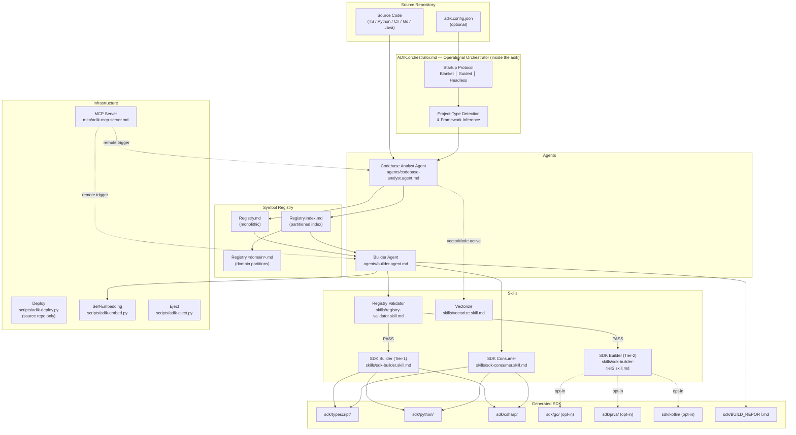
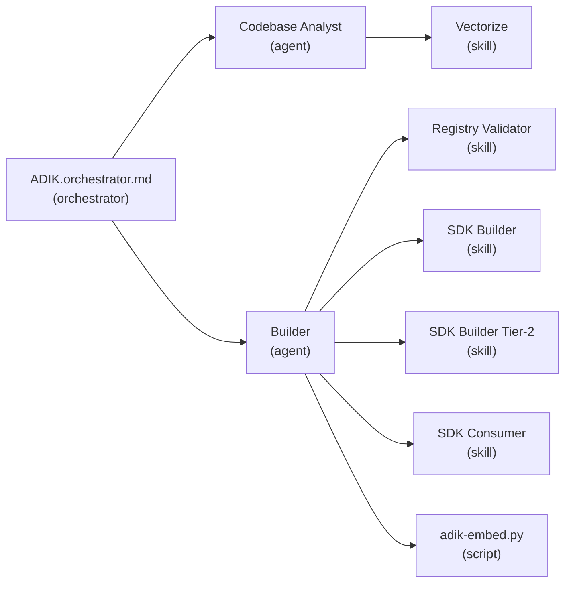

# Architecture — How ADIK Works

> **Part of:** [ADIK — Agentic Development and Implementation Kit](../README.md)

---

## System Overview

ADIK is a multi-agent system coordinated by a single orchestrator. The diagram below shows the full flow from source code to published SDK packages.



---

## Two Orchestrators

ADIK has a factory orchestrator and a specialized orchestrator that ships in every adik:

| Orchestrator | File | Audience | Deployed? |
|---|---|---|---|
| **Factory** | `ADIKbuilder.md` | ADIK framework maintainers (this source repo) | No |
| **Standard Definition** | `ADIK.md` | Everyone — defines ADIK terminology, contracts, and principles | Yes |
| **Operational Orchestrator** | `ADIK.orchestrator.md` | SDK consumers in target repositories (inside every adik) | Yes |

`ADIKbuilder.md` is the factory — it produces specialized adiks (self-sustaining agentic SDK bundles). `ADIK.md` is the standard definition — it defines what ADIK is. `ADIK.orchestrator.md` is the brain inside every adik — it drives the actual SDK generation, implementation, and maintenance pipeline.

---

## Agent → Skill Delegation Model

ADIK follows a strict **orchestrator → agent → skill** delegation hierarchy:



**Agents** make decisions (what to analyse, which languages to build, how to handle errors).
**Skills** execute a single well-defined task (generate Go code, validate the registry, embed vectors).
**Scripts** are deterministic utilities (self-embedding, ejection, deployment) that agents invoke but never reimplement.

---

## Data Flow

```
Source Code
    │
    ▼
┌──────────────────────┐
│  Codebase Analyst    │  Scans source, detects symbols, infers frameworks
│  Agent               │  Writes: Registry.md (or partitioned registries)
└──────────┬───────────┘
           │
           ▼
┌──────────────────────┐
│  Registry Validator  │  Three-level gate: Structural → Type → Semantic
│  Skill               │  Writes: sdk/VALIDATION_REPORT.md
└──────────┬───────────┘
           │ PASS
           ▼
┌──────────────────────┐
│  Builder Agent       │  Coordinates SDK generation across all languages
│                      │  Invokes: SDK Builder → SDK Consumer → Self-Embed
└──────────┬───────────┘
           │
     ┌─────┼─────┐
     ▼     ▼     ▼
   TS/   Py/   C#/     ← Tier-1 (always)
   Go/   Java/ Kotlin/  ← Tier-2 (opt-in)
```

---

## Registry Model

The Registry is the single source of truth. Every symbol in the SDK must first be declared in the Registry.

### Monolithic Mode (default)

A single `Registry.md` file containing all symbols. Works well for projects with < 500 symbols.

### Partitioned Mode (auto-triggered)

When symbol count ≥ 500, the Codebase Analyst automatically partitions:

```
Registry.index.md          ← Master index with partition table
Registry.auth.md           ← Auth domain symbols
Registry.payments.md       ← Payments domain symbols
Registry.users.md          ← Users domain symbols
```

Agents load only the partitions they need, keeping context windows manageable.

---

## Optional Features

All features below are additive. The core pipeline (Analyst → Validator → Builder) works with zero configuration.

| Feature | Trigger | Component |
|---|---|---|
| **Tier-2 languages** | `tier2Languages` in `adik.config.json` | `skills/sdk-builder-tier2.skill.md` |
| **Vector search** | Vector DB detected in environment | `skills/vectorize.skill.md` |
| **MCP server** | Manual setup | `mcp/adik-mcp-server.md` |
| **Framework hints** | Auto-inferred from package manifests | `skills/sdk-consumer.skill.md` |
| **Headless/CI mode** | `ADIK_NON_INTERACTIVE=true` | `ADIK.orchestrator.md` startup protocol |
| **Self-embedding** | Automatic post-build | `scripts/adik-embed.py` |

---

## Related Reading

| Document | Purpose |
|---|---|
| [README](../README.md) | Overview and quick start |
| [Manifesto](manifesto.md) | Philosophy and principles |
| [Build Your Own ADIK](examples/ADIKBuilderExample.md) | Step-by-step construction guide |
| [Red-Team Audit v2](red-team-audit-v2.md) | Security audit and risk matrix |
