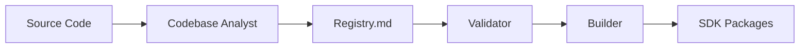

# ADIK — Agentic Development and Implementation Kit

**ADIK** is a framework standard for fully automated, AI-driven SDK generation. A team of cooperating agents reads your codebase, builds a language-agnostic symbol registry, and generates publish-ready SDK packages in TypeScript, Python, C#, and optionally Go, Java, and Kotlin.

> This is the documentation site for the ADIK framework. For the source repository, see [GitHub](https://github.com/mateors1/adik.md-agentic-development-and-implementation-kit-Framework).

---

## The Pipeline



1. **Codebase Analyst Agent** scans your source and populates `Registry.md` with every public symbol.
2. **Registry Validator Skill** runs a three-level gate (structural → type → semantic) before generation.
3. **Builder Agent** coordinates SDK generation, invoking tier-1 and tier-2 skills per language.
4. **SDK Consumer Skill** produces framework-idiomatic examples, DI wiring, and boilerplate.
5. **Vectorize Skill** optionally embeds the registry for semantic search when a vector DB is present.

All features beyond the core pipeline — vector search, MCP server, tier-2 languages, framework hints — are additive and degrade gracefully when not configured.

---

## Quick Start

```bash
# 1. Copy the ADIK bundle into your project
cp -r adik-bundle/* /path/to/your/project/

# 2. Analyse your codebase
@agent codebase-analyst task: analyse-and-register target: ./src

# 3. Build the SDK
@agent builder task: build-sdk registry: Registry.md languages: [typescript, python, csharp]
```

Output appears in `sdk/typescript/`, `sdk/python/`, `sdk/csharp/`.

---

## Core Principles

| Principle | Summary |
|---|---|
| **One Source of Truth** | Every symbol is declared once in `Registry.md` and generated into all target languages |
| **Inference Over Configuration** | ADIK detects frameworks, project type, and vector capabilities automatically |
| **Context Cleanliness** | Each agent and skill file does exactly one thing — context windows stay manageable |
| **Graceful Degradation** | All features are additive — the core pipeline works with zero configuration |

Read the full [Manifesto](manifesto.md) for the philosophy behind these principles.

---

## Supported Languages

| Tier | Language | Package Manager | Output |
|---|---|---|---|
| **1** | TypeScript | npm / pnpm / yarn | ESM + CJS + `.d.ts` |
| **1** | Python | pip / poetry / uv | Wheel + sdist |
| **1** | C# | NuGet | `.nupkg` |
| **2** *(opt-in)* | Go | go modules | Go module |
| **2** *(opt-in)* | Java | Maven / Gradle | JAR |
| **2** *(opt-in)* | Kotlin | Gradle | JAR (coroutines) |

---

## Learn More

| Document | Description |
|---|---|
| [ADIK Standard Specification](standard.md) | Formal spec — conformance levels, contracts, protocols |
| [Architecture](architecture.md) | System diagram, agent delegation model, data flow |
| [Manifesto](manifesto.md) | Philosophy and core principles |
| [Pre-Deployment Walkthrough](examples/pre-deployment.md) | What the bundle looks like before running |
| [Showcase: Payments API](examples/showcase-payments-api.md) | Full example — NestJS REST API |
| [Showcase: Task Manager](examples/showcase-task-manager.md) | Full example — FastAPI with webhooks |
| [Showcase: Chat Service](examples/showcase-chat-service.md) | Full example — TypeScript WebSocket + REST |
| [Scaffold (Master Prompt)](examples/scaffold.md) | Single file that bootstraps ADIK into any repo |
| [Build Your Own ADIK](examples/ADIKBuilderExample.md) | Step-by-step construction guide |
| [Red-Team Audit v2](red-team-audit-v2.md) | Security audit and risk matrix |
| [Changelog](https://github.com/mateors1/adik.md-agentic-development-and-implementation-kit-Framework/blob/main/CHANGELOG.md) | Version history |

---

## Licensing

| Component | License |
|---|---|
| **Specification** — `ADIK.md`, `ADIK.orchestrator.md`, `ADIKbuilder.md`, `Registry.md`, `docs/` | [CC BY 4.0](https://creativecommons.org/licenses/by/4.0/) |
| **Reference Implementation** — `agents/`, `skills/`, `scripts/`, `mcp/` | [Apache 2.0](http://www.apache.org/licenses/LICENSE-2.0) |

See [`LICENSE`](https://github.com/mateors1/adik.md-agentic-development-and-implementation-kit-Framework/blob/main/LICENSE) for full terms.
