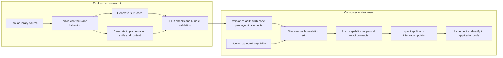
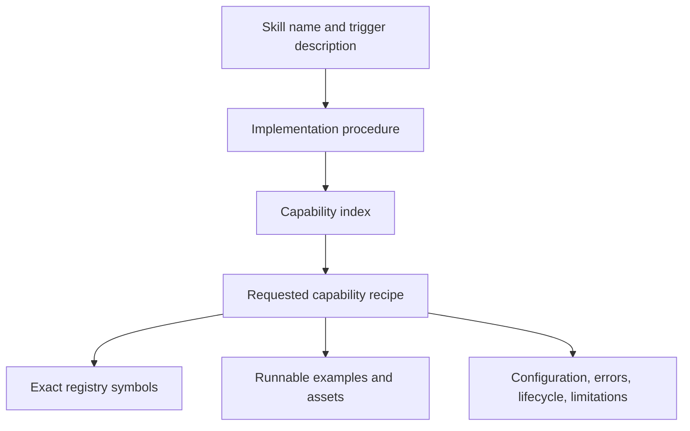

# ADIK architecture and handoff

The developer calls ADIK to build an adik. Generation produces SDK source code and
matching implementation knowledge as one deliverable. A user's coding agent then
uses that adik to implement capabilities in application code.

## Context has two owners

| Context | Owner | Contents |
|---|---|---|
| Library contract | Producer | Symbols, semantics, version, configuration, errors, lifecycle |
| Application context | Consumer | Framework, dependency manager, conventions, composition root, call sites |

The completed adik carries producer knowledge. The consumer agent gathers only the
application information needed for the integration. A producer's NestJS implementation
does not imply that its consumer application uses NestJS.

## Load only relevant implementation knowledge

## Runtime responsibilities

The host coding agent runs the producer or consumer procedure with its tools. ADIK
supplies skills, artifacts, and deterministic validation/registration helpers. MCP is
an optional interface to helpers and instruction handoffs. External schedulers can
invoke a host agent for refresh jobs when the developer chooses to configure them.

## Artifact boundaries

The framework source produces a generation-toolkit bootstrap. A host agent uses that
toolkit to generate a completed adik. The complete bundle is transported together;
native adapters register its implementation skills without changing their internal
references. The reference installer uses package-specific paths and ownership receipts.

[Download the diagram source](../assets/adik-lifecycle.mmd) ·
[View the standalone diagram](../assets/adik-lifecycle.svg)
